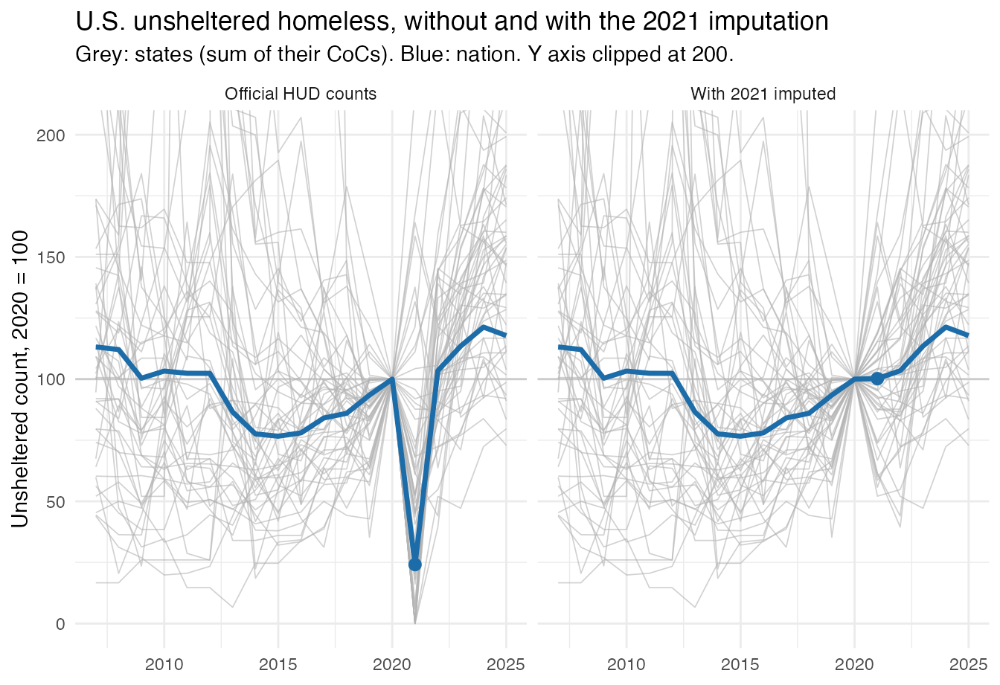
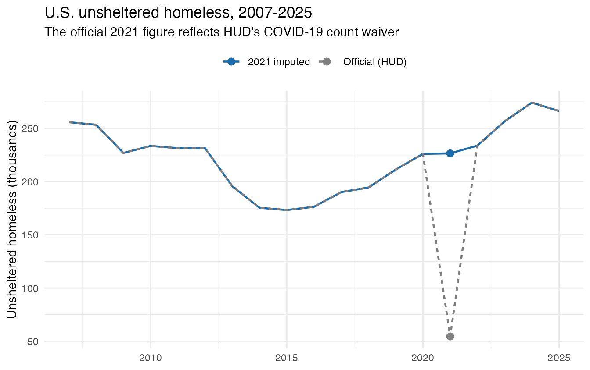
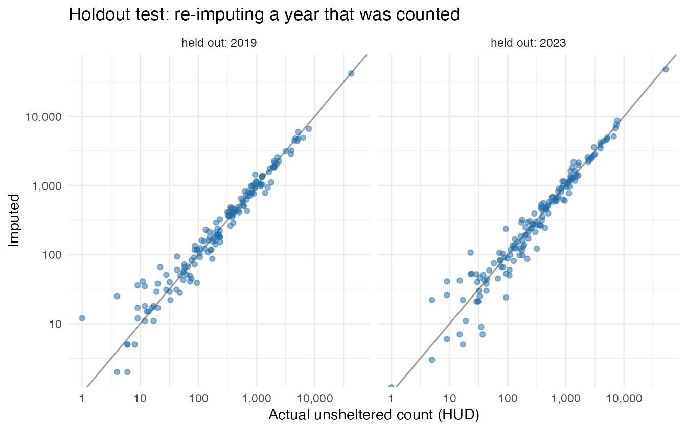
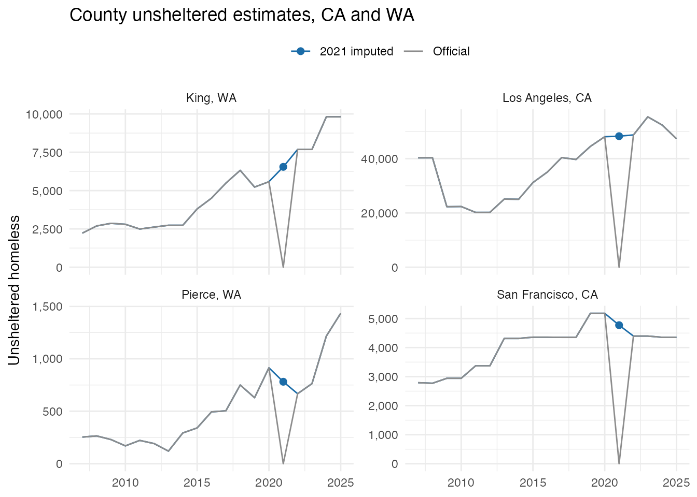

# Imputing the 2021 unsheltered count

``` r

library(COCHomeless)
```

In January 2021, during COVID-19, HUD allowed Continuums of Care (CoCs)
to skip the unsheltered part of the Point-in-Time (PIT) count. Many did,
and report **0 unsheltered people** for 2021. Taken at face value, those
zeros put a hole in every unsheltered and total series that runs through
2021.

COCHomeless leaves HUD’s published figures alone and adds **separate,
flagged columns** with an imputed value for the missing counts:

| dataset | official (HUD) | with 2021 imputed | flag |
|----|----|----|----|
| `pit_coc` | `total`, `unsheltered` | `total_imp`, `unsheltered_imp` | `unsheltered_imputed`, `imputation_method` |
| `county_pit` | `total`, `unsheltered` | `total_imp`, `unsheltered_imp` | `unsheltered_imputed` |
| `pit_us` | `total`, `unsheltered` | `total_imp`, `unsheltered_imp` | `n_coc_imputed` |

Outside the imputed CoC-years the `_imp` columns equal the official
ones, so you can use the `_imp` columns throughout for trend analysis
and the official columns whenever you need to reproduce HUD. The same
note travels with the data:

``` r

cat(strwrap(attr(pit_coc, "note")), sep = "\n")
#> unsheltered_imp / total_imp: HUD's 2021 COVID waiver let CoCs skip the
#> unsheltered count. Where a CoC reported 0 unsheltered in 2021 but
#> counted unsheltered people in the years either side, unsheltered_imp is
#> an ARIMA / Kalman-smoothed estimate (flag unsheltered_imputed = TRUE).
#> Everywhere else unsheltered_imp == unsheltered. HUD's official columns
#> are unchanged. See vignette('unsheltered-imputation', package =
#> 'COCHomeless').
```

## National overview

``` r

pit_us[pit_us$year %in% 2019:2023,
       c("year", "unsheltered", "unsheltered_imp", "total", "total_imp", "n_coc_imputed")]
#>    year unsheltered unsheltered_imp  total total_imp n_coc_imputed
#> 13 2019      211293          211293 567715    567715             0
#> 14 2020      226080          226080 580466    580466             0
#> 15 2021       54504          226529 380630    552655           159
#> 16 2022      233832          233832 582462    582462             0
#> 17 2023      256610          256610 653104    653104             0
```

### With and without the imputation

The two panels below show the same series. The left panel uses HUD’s
official counts and the right panel uses the `_imp` columns. To put
states of very different sizes on one axis, every series is indexed to
its 2020 count (2020 = 100). Each grey line is a state, built by summing
its CoCs in `pit_coc`. The heavy line is the nation.

``` r

library(ggplot2)
st <- aggregate(cbind(unsheltered, unsheltered_imp) ~ state + year,
                data = transform(pit_coc, state = substr(coc_num, 1, 2)), FUN = sum)
st <- st[st$state %in% state.abb | st$state == "DC", ]
nat_s <- data.frame(state = "US", year = pit_us$year,
                    unsheltered = pit_us$unsheltered, unsheltered_imp = pit_us$unsheltered_imp)
index_2020 <- function(d, col) {
  base <- d[d$year == 2020, c("state", col)]
  names(base)[2] <- "base"
  d <- merge(d, base, by = "state")
  d$index <- 100 * d[[col]] / d$base
  d[d$base > 0, c("state", "year", "index")]
}
panel <- function(col, label) {
  rbind(cbind(index_2020(st, col), level = "State"),
        cbind(index_2020(nat_s, col), level = "United States")) |>
    transform(panel = label)
}
both <- rbind(panel("unsheltered", "Official HUD counts"),
              panel("unsheltered_imp", "With 2021 imputed"))
both$panel <- factor(both$panel, c("Official HUD counts", "With 2021 imputed"))
ggplot(both, aes(year, index, group = state)) +
  geom_hline(yintercept = 100, colour = "grey80") +
  geom_line(data = subset(both, level == "State"), colour = "grey70",
            alpha = 0.6, linewidth = 0.3) +
  geom_line(data = subset(both, level == "United States"), colour = "#1b6ca8",
            linewidth = 1.2) +
  geom_point(data = subset(both, level == "United States" & year == 2021),
             colour = "#1b6ca8", size = 2.5) +
  facet_wrap(~ panel) +
  coord_cartesian(ylim = c(0, 200)) +
  labs(x = NULL, y = "Unsheltered count, 2020 = 100",
       title = "U.S. unsheltered homeless, without and with the 2021 imputation",
       subtitle = "Grey: states (sum of their CoCs). Blue: nation. Y axis clipped at 200.") +
  theme_minimal(base_size = 11)
```



On the left, 2021 falls sharply for the nation and drops to near zero
for several states. That drop comes from the waiver and does not reflect
a real change. On the right, the imputed values close the gap, and 2021
sits between 2020 and 2022 for the nation and for most states. States
that still dip on the right did partial 2021 counts. Those counts are
kept as HUD reported them (see *Cautions*).

The same comparison in raw counts:

``` r

nat <- rbind(
  data.frame(year = pit_us$year, value = pit_us$unsheltered, series = "Official (HUD)"),
  data.frame(year = pit_us$year, value = pit_us$unsheltered_imp, series = "2021 imputed"))
ggplot(nat, aes(year, value / 1000, colour = series, linetype = series)) +
  geom_line(linewidth = 0.8) +
  geom_point(data = subset(nat, year == 2021), size = 2.5) +
  scale_colour_manual(values = c("Official (HUD)" = "grey50", "2021 imputed" = "#1b6ca8")) +
  labs(x = NULL, y = "Unsheltered homeless (thousands)", colour = NULL, linetype = NULL,
       title = "U.S. unsheltered homeless, 2007-2025",
       subtitle = "The official 2021 figure reflects HUD's COVID-19 count waiver") +
  theme_minimal(base_size = 11) + theme(legend.position = "top")
```



## Which counts are imputed

A 2021 value is treated as **missing** only when all three hold:

1.  the CoC reported **0** unsheltered people in 2021;
2.  it reported **more than 0** in the nearest earlier year; and
3.  it reported **more than 0** in the nearest later year.

A CoC that genuinely never finds unsheltered people keeps its zero, and
a CoC that did a partial 2021 count (a low but non-zero number) is
**not** imputed. Nothing outside 2021 is imputed.

``` r

imp <- pit_coc[pit_coc$unsheltered_imputed, ]
nrow(imp)                                   # CoC-years imputed
#> [1] 159
table(imp$imputation_method)
#> 
#>      arima_kalman log_linear_interp 
#>               157                 2
head(sort(table(substr(imp$coc_num, 1, 2)), decreasing = TRUE), 10)  # by state
#> 
#> CA FL MI MN GA NY IL OH WA LA 
#> 36 11 10  8  7  7  6  6  6  5
```

## Method

For each affected CoC, the unsheltered series for 2007-2025 is modelled
on the log scale, `log(1 + unsheltered)`, with 2021 treated as missing:

- an ARIMA model is selected automatically
  ([`forecast::auto.arima`](https://pkg.robjhyndman.com/forecast/reference/auto.arima.html)),
  **required to difference once** (`d = 1`);
- the missing year is filled by **Kalman smoothing**
  ([`imputeTS::na_kalman`](https://SteffenMoritz.github.io/imputeTS/reference/na_kalman.html)),
  so the estimate uses the years after 2021 as well as those before;
- the value is back-transformed and rounded. It is never negative.

A CoC with fewer than six observed years (two in this release) falls
back to linear interpolation on the log scale; `imputation_method`
records which was used.

**Why `d = 1`.** Without it, `auto.arima` usually picks a *stationary*
model, which pulls the gap toward the CoC’s long-run average. That
average is dominated by the higher or lower counts of the late 2000s,
not 2020 and 2022. In the holdout test below, the unconstrained model
was about 20% low in total. Forcing one difference removes that bias.

Here is the procedure for one CoC, Seattle/King County (WA-500):

``` r

d <- pit_coc[pit_coc$coc_num == "WA-500", ]
z <- log1p(d$unsheltered)
z[d$year == 2021] <- NA
fit <- forecast::auto.arima(ts(z, start = min(d$year)), d = 1)
fit
#> Series: ts(z, start = min(d$year)) 
#> ARIMA(0,1,0) with drift 
#> 
#> Coefficients:
#>        drift
#>       0.0825
#> s.e.  0.0304
#> 
#> sigma^2 = 0.01773:  log likelihood = 10.33
#> AIC=-16.65   AICc=-15.85   BIC=-14.87
smoothed <- imputeTS::na_kalman(ts(z, start = min(d$year)), model = fit$model)
round(expm1(smoothed[d$year == 2021]))       # imputed 2021
#> [1] 6547
d$unsheltered_imp[d$year == 2021]            # value shipped in pit_coc
#> [1] 6547
```

## How well does it work?

There is no true 2021 count to check against, so the method is tested on
years that *were* counted. For the same CoCs, 2019 and then 2023 are
hidden (2021 is dropped too), re-imputed with the identical procedure,
and compared with HUD’s actual figure:

``` r

bt <- read.csv(system.file("extdata", "unsheltered_backtest.csv", package = "COCHomeless"))
err <- function(b) c(
  CoCs = nrow(b),
  median_abs_error_pct = round(100 * median(abs(b$imputed - b$actual) / b$actual), 1),
  total_error_pct = round(100 * (sum(b$imputed) - sum(b$actual)) / sum(b$actual), 1),
  within_25pct = round(100 * mean(abs(b$imputed - b$actual) / b$actual < 0.25)))
do.call(rbind, lapply(split(bt, bt$hold_year), err))
#>      CoCs median_abs_error_pct total_error_pct within_25pct
#> 2019  156                 15.6            -4.4           67
#> 2023  157                 16.8            -3.3           61
```

``` r

ggplot(bt, aes(actual, imputed)) +
  geom_abline(colour = "grey60") +
  geom_point(alpha = 0.5, colour = "#1b6ca8") +
  scale_x_log10(labels = scales::comma) + scale_y_log10(labels = scales::comma) +
  facet_wrap(~ hold_year, labeller = labeller(hold_year = function(x) paste("held out:", x))) +
  labs(x = "Actual unsheltered count (HUD)", y = "Imputed",
       title = "Holdout test: re-imputing a year that was counted") +
  theme_minimal(base_size = 11)
#> Warning in scale_y_log10(labels = scales::comma): log-10
#> transformation introduced infinite values.
```



Read these results this way. The national and state totals are close (a
few percent low). An individual CoC’s imputed value is typically within
about 15% of the truth, and within 25% about two times in three. For any
one small CoC, it can be well off.

## County level

The imputed CoC addition (`unsheltered_imp - unsheltered`) is pushed
down to counties with **exactly the split the county estimates use**:
each county gets the share of the CoC’s people it was apportioned in
`county_coc_alloc`, rounded so the CoC’s addition is preserved. Counties
with no CoC, which are filled by the spatial model in `homeless`, are
not adjusted.

### California and Washington

``` r

focus <- c("06037" = "Los Angeles, CA", "06075" = "San Francisco, CA",
           "53033" = "King, WA", "53053" = "Pierce, WA")
cp <- county_pit[county_pit$fips %in% names(focus) & county_pit$year %in% 2019:2023, ]
cp$county <- focus[cp$fips]
cp[order(cp$county, cp$year),
   c("county", "year", "unsheltered", "unsheltered_imp", "unsheltered_imputed")]
#>                  county year unsheltered unsheltered_imp unsheltered_imputed
#> 56462          King, WA 2019        5228            5228               FALSE
#> 56463          King, WA 2020        5578            5578               FALSE
#> 56464          King, WA 2021           0            6547                TRUE
#> 56465          King, WA 2022        7685            7685               FALSE
#> 56466          King, WA 2023        7685            7685               FALSE
#> 3908    Los Angeles, CA 2019       44494           44494               FALSE
#> 3909    Los Angeles, CA 2020       48065           48065               FALSE
#> 3910    Los Angeles, CA 2021           0           48261                TRUE
#> 3911    Los Angeles, CA 2022       48720           48720               FALSE
#> 3912    Los Angeles, CA 2023       55386           55386               FALSE
#> 56652        Pierce, WA 2019         629             629               FALSE
#> 56653        Pierce, WA 2020         914             914               FALSE
#> 56654        Pierce, WA 2021           0             781                TRUE
#> 56655        Pierce, WA 2022         667             667               FALSE
#> 56656        Pierce, WA 2023         763             763               FALSE
#> 4269  San Francisco, CA 2019        5180            5180               FALSE
#> 4270  San Francisco, CA 2020        5180            5180               FALSE
#> 4271  San Francisco, CA 2021           0            4772                TRUE
#> 4272  San Francisco, CA 2022        4397            4397               FALSE
#> 4273  San Francisco, CA 2023        4397            4397               FALSE
```

``` r

cp <- county_pit[county_pit$fips %in% names(focus), ]
cp$county <- focus[cp$fips]
long <- rbind(
  data.frame(cp[, c("county", "year")], value = cp$unsheltered, series = "Official"),
  data.frame(cp[, c("county", "year")], value = cp$unsheltered_imp, series = "2021 imputed"))
ggplot(long, aes(year, value, colour = series)) +
  geom_line() +
  geom_point(data = subset(long, year == 2021 & series == "2021 imputed"), size = 2) +
  facet_wrap(~ county, scales = "free_y") +
  scale_colour_manual(values = c("Official" = "grey55", "2021 imputed" = "#1b6ca8")) +
  scale_y_continuous(labels = scales::comma) +
  labs(x = NULL, y = "Unsheltered homeless", colour = NULL,
       title = "County unsheltered estimates, CA and WA") +
  theme_minimal(base_size = 11) + theme(legend.position = "top")
```



## Cautions

- **These are model estimates, not counts.** No uncertainty interval is
  shipped. For inference that depends on 2021, run sensitivity analyses:
  drop 2021, use the official values, or use the imputed ones.
- **Partial 2021 counts are kept as reported.** Some CoCs did a reduced
  unsheltered count and report a low, non-zero number. Those values are
  HUD’s and are not imputed, so 2021 may still run somewhat low in those
  CoCs.
- **Sheltered counts are not imputed.** 2021 sheltered counts were
  collected, though shelter capacity itself fell during the pandemic.
- **County imputation inherits the apportionment.** A county’s imputed
  people are its CoC’s imputed people, split the way the county
  estimates split the CoC. They are only as good as that split.
- **Territories.** Imputed territory CoCs (GU, MP, PR) are included in
  `pit_coc` and `pit_us` but have no counties in `county_pit`.
